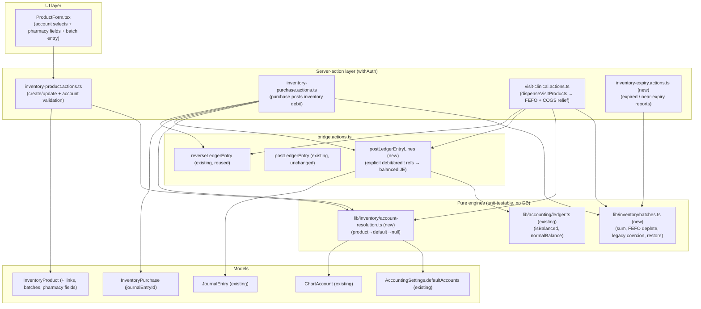

# Design Document

## Overview

This feature layers three additive capabilities onto the existing `InventoryProduct` record without
changing any already-recorded monetary amount or destroying any existing data:

1. **Per-product account linking** — optional `inventoryAccountId`, `revenueAccountId`, and
   `cogsAccountId` references to `ChartAccount`, validated by account `type`, with fallback to
   `AccountingSettings.defaultAccounts`.
2. **Full inventory accounting** — a PURCHASE debits the product's resolved Inventory asset account and
   credits Accounts Payable (supplier present) or Cash, replacing the hardcoded `"Dental Supplies"`
   expense. A SALE/DISPENSE moves cost from the Inventory asset account to COGS. Posting stays
   best-effort and never blocks the inventory/clinical save.
3. **Batch / lot tracking with expiry** — a product owns many embedded batches (lot number, expiry,
   quantity, plus optional manufacture date, cost, supplier, received-at). `product.quantity` becomes
   the derived sum of batch quantities, enabling FEFO depletion, near-expiry/expired reporting, and a
   dispense-expired guard. Additional optional pharmacy fields are also added.

The guiding principle is **additive, graceful degradation**: existing products (scalar `quantity`, no
links, no batches) keep working; a legacy scalar quantity is treated as an opening batch lazily when a
batch-aware operation first runs; missing account mappings cause a *skip-and-log*, never a thrown error.

### Key investigation finding — revenue is already recognized (double-counting avoidance)

The repo already recognizes product-sale revenue through the **billing/payment path**, not at dispense
time:

- `dispenseVisitProducts` (`lib/actions/visit-clinical.actions.ts`, ~lines 484-562) prices each line at
  the product's `salePrice`, reconciles stock by the DELTA vs the previously-dispensed quantity on the
  visit, writes `visit.billing.dispensedProducts`, then calls `recomputeVisitBilling` + `syncInvoiceIfExists`.
  Dispensed products therefore become part of the invoice total.
- `recordVisitPayment` (same file, ~lines 838-940) posts income to the ledger **exactly once** via
  `postLedgerEntry({ type: "income", ... })`, driven by the invoice/payment amount. The comment there
  is explicit: *"This is the single revenue path … posts income to the ledger ONCE."*

**Decision:** Revenue recognition stays entirely in the existing invoice/payment flow. R4.1's
revenue-credit requirement is **satisfied by that existing path**, so this feature does **not** post a
second revenue JE at dispense time. The new accounting work at dispense time is the **COGS / inventory
relief** entry only (R4.2: debit COGS, credit Inventory). This is called out again in the Posting Flows
section and is the single most important design decision for correctness.

---

## Architecture



Design intent, consistent with existing house conventions:

- **Pure engines first.** All batch math (sum, FEFO depletion, legacy coercion, restore-on-decrease) and
  account resolution live in dependency-free modules under `lib/inventory/`, mirroring how
  `lib/accounting/ledger.ts` and `lib/accounting/coa.ts` are extracted for unit testing. The action
  layer orchestrates DB reads/writes and calls these pure functions.
- **Best-effort bridge posting.** New posting goes through a new `postLedgerEntryLines` helper in
  `bridge.actions.ts` that reuses the existing JE-creation internals, returns a JE id, is non-throwing,
  and is reversible via the existing `reverseLedgerEntry`.
- **Conventions preserved.** Server actions stay `withAuth`-gated, return
  `JSON.parse(JSON.stringify(...))`, write `History` audit records, and never let an accounting problem
  block an inventory/clinical save.

---

## Components and Interfaces

### 1. Account resolution engine — `lib/inventory/account-resolution.ts` (new, pure)

Implements R2's product→default→skip order. Pure resolution logic is separated from the DB lookup so it
is unit-testable; the action layer supplies already-fetched candidates.

```ts
export type ResolvedSide = { accountId: string; code: string } | null;

/** Pick the product link if set, else the settings default code, else null. */
export function pickAccountCode(
    productLinkCode: string | null | undefined,
    defaultCode: string | null | undefined,
): string | null;
```

The action-layer wrapper (in `inventory-product.actions.ts` or a small server helper) resolves a code to
an **active, non-deleted** `ChartAccount` using the same `del_flag`/`isActive` posture as
`resolveAccountByCode` in `bridge.actions.ts`, returning `null` when nothing resolves (R2.4).

### 2. Batch engine — `lib/inventory/batches.ts` (new, pure)

```ts
export interface Batch {
    batchNumber: string;
    expiryDate: string | null;      // ISO; null = no expiry (e.g. legacy opening batch)
    quantity: number;               // non-negative
    manufactureDate?: string | null;
    costPerUnit?: number | null;
    supplierId?: string | null;
    receivedAt?: string | null;
}

/** R6.1: product.quantity invariant. */
export function sumBatchQuantity(batches: Batch[]): number;

/** R7.1/R7.2: coerce a legacy scalar quantity to a single opening batch (no expiry). */
export function coerceLegacyToOpeningBatch(quantity: number, batches: Batch[]): Batch[];

/** R8.5: batches available for depletion = non-expired, positive-qty, FEFO-ordered. */
export function availableForFefo(batches: Batch[], now: Date): Batch[];

/**
 * R6.3/R6.4/R8.4: deplete `qty` units in FEFO order over non-expired batches.
 * Returns updated batches + per-batch consumption (with costPerUnit) for COGS.
 * Throws a tagged InsufficientStockError if non-expired available < qty.
 */
export function depleteFefo(
    batches: Batch[],
    qty: number,
    now: Date,
): { batches: Batch[]; consumed: { batchNumber: string; quantity: number; costPerUnit: number | null }[] };

/** R6.3 restore: add `qty` back (used when a dispensed quantity decreases). */
export function restoreStock(batches: Batch[], qty: number, hint?: Partial<Batch>): Batch[];

/** R8.1/R8.2/R8.3: classify batches relative to now + threshold (default 90 days). */
export function classifyExpiry(
    batches: Batch[],
    now: Date,
    thresholdDays?: number,
): { expired: Batch[]; nearExpiry: Batch[] };
```

Depletion precedence: skip expired batches entirely (R8.5), consume earliest `expiryDate` first; batches
with no expiry sort **after** dated batches (so dated stock is used before open-ended legacy stock).

### 3. Bridge extension — `postLedgerEntryLines` in `lib/actions/accounting/bridge.actions.ts` (new)

**Decision (design-phase item 3): add a new helper rather than overloading `postLedgerEntry`.** The
existing `postLedgerEntry` only knows the global income/expense pair and is relied on by many callers;
inventory postings need explicit per-account debit/credit sides (R3/R4). A dedicated helper keeps the
existing contract untouched and keeps the new behavior focused.

```ts
interface LedgerLineInput {
    accountId: string;   // resolved ChartAccount _id
    debit?: number;
    credit?: number;
    memo?: string;
}

interface JournalPostInput {
    lines: LedgerLineInput[];     // must balance per isBalanced()
    memo?: string;
    date?: string;
    source?: IJournalEntry["source"];
    sourceId?: string | null;
    vendorId?: string | null;
}

/** Best-effort, non-throwing. Returns the created JE (plain, with journalEntryId alias) or null. */
export async function postLedgerEntryLines(user: User, input: JournalPostInput): Promise<Record<string, unknown> | null>;
```

It reuses the exact JE-creation internals already present (`generateBridgeEntryNo`, `isBalanced` guard
before save, `status: "posted"`, basis from settings, `History` write), returns
`JSON.parse(JSON.stringify(entry))` with a `journalEntryId` alias equal to `_id` (matching D2), and
returns `null` on any skip (missing account, unbalanced, non-positive total). Reversal reuses the
existing `reverseLedgerEntry(user, journalEntryId)` unchanged.

### 4. Product actions — `lib/actions/inventory-product.actions.ts`

- `createProduct` / `updateProduct` accept optional `inventoryAccountId`, `revenueAccountId`,
  `cogsAccountId` and the new pharmacy fields; validate each supplied link resolves to an active
  `ChartAccount` of the correct `type` (R1.3–R1.6), else throw a field-identifying validation error;
  blank links persist as `null` (R1.7). Gated by `inventoryManagement` (R10.1).
- New `listProductBatches(productId)` and `addOrUpdateBatch` / batch-mutating helpers keep
  `product.quantity = sumBatchQuantity(batches)` on every batch change (R6.1), reject negative quantity
  (R5.4) and `expiryDate < manufactureDate` (R5.5). Gated by `inventoryManagement`.

### 5. Expiry reporting — `lib/actions/inventory-expiry.actions.ts` (new)

- `listExpiredBatches()` and `listNearExpiryBatches(thresholdDays?)` read products, lazily coerce legacy
  quantity to an opening batch for classification, and return flattened batch rows with product context
  (R8.1–R8.3). Gated by `inventoryManagement`.

### 6. Purchase actions — `lib/actions/inventory-purchase.actions.ts`

Rewrite `_createPurchase` and `_deletePurchase` per R3 (see Posting Flows). Store the returned JE id on a
new `journalEntryId` field; keep reversing on delete.

### 7. Dispense integration — `lib/actions/visit-clinical.actions.ts`

Extend `_dispenseVisitProducts` to deplete/restore batches via the batch engine (mirroring its existing
scalar delta logic) and post the COGS relief entry (see Posting Flows). No change to the revenue path.

### 8. UI — `ProductForm.tsx`

Three account `Select`s (filtered by type), new pharmacy fields, and batch entry rows; `isDrug`
conditional reveal preserved (see UI Changes).

---

## Data Models

### `InventoryProduct` schema diff — `lib/models/inventory-product.models.ts`

```ts
// NEW — Chart-of-Accounts links (all optional; null = fall back to defaults)
inventoryAccountId: { type: Schema.Types.ObjectId, ref: "ChartAccount", default: null },
revenueAccountId:   { type: Schema.Types.ObjectId, ref: "ChartAccount", default: null },
cogsAccountId:      { type: Schema.Types.ObjectId, ref: "ChartAccount", default: null },

// NEW — embedded batches (see decision below)
batches: [
    {
        batchNumber:     { type: String, required: true },
        expiryDate:      { type: Date, default: null },
        quantity:        { type: Number, required: true, min: 0 },
        manufactureDate: { type: Date, default: null },
        costPerUnit:     { type: Number, default: null },
        supplierId:      { type: Schema.Types.ObjectId, ref: "InventorySupplier", default: null },
        receivedAt:      { type: Date, default: null },
    }
],

// NEW — additional pharmacy fields
genericName:         { type: String, default: "" },
manufacturer:        { type: String, default: "" },
barcode:             { type: String, default: "" },
storageConditions:   { type: String, default: "" },
controlledSubstance: { type: Boolean, default: false },

// quantity: KEPT as the DERIVED sum of batch quantities (not removed, for backward compat).
```

Matching `IInventoryProduct` additions go in `lib/types.d.ts` (optional fields so existing readers keep
compiling — R7.3).

**Decision (design-phase item 1): embedded batches subdocument array, not a separate collection.**

- *For embedded:* matches the repo's existing embedded-array style (`purchaseItems` on
  `InventoryPurchase`, `dispensedProducts` on the visit bill); keeps `product.quantity` and its batches
  in one atomic document so the sum invariant (R6.1) is trivially consistent; simpler reads for the
  product/pharmacy views; no cross-collection joins for expiry reports.
- *Against (separate collection):* better for very high lot counts per product and for querying batches
  globally.
- *Rationale:* a clinic/optical pharmacy has a small number of lots per product; the sum invariant and
  FEFO depletion are far simpler and safer to keep correct inside one document; this matches house
  style. **Chosen: embedded.** A note is left that extracting to a `Batch` collection is a clean future
  migration if lot cardinality grows.

### `InventoryPurchase` schema diff — `lib/models/inventory-purchase.models.ts`

```ts
// NEW — JE id of the inventory-debit posting (R3.4). `transactionId` is KEPT as-is
// for backward compat (R7.4); new purchases use journalEntryId.
journalEntryId: { type: Schema.Types.ObjectId, ref: "JournalEntry", default: null },
```

`AccountingSettings.defaultAccounts` already carries `inventory` (1200), `accountsPayable` (2000),
`cash` (1000), `revenue` (4000), and `expense` (6900) — no settings-model change is required; resolution
reads these existing codes.

---

## Correctness Properties

*A property is a characteristic or behavior that should hold true across all valid executions of a
system — a formal statement about what the system should do. Properties serve as the bridge between
human-readable specifications and machine-verifiable correctness guarantees.*

The batch engine and account-resolution engine are **pure functions** with a large, structured input
space (batch lists, quantities, dates), which is exactly where property-based testing earns its keep.
The posting flows themselves (JE writes against Mongoose/CloudWatch-like external state) are covered by
example/integration tests, not PBT. The prework below classifies every acceptance criterion.

### Property 1: Quantity equals sum of batches

*For any* list of batches, after any create/update/deplete/restore operation, the product's `quantity`
equals `sumBatchQuantity(batches)`.

**Validates: Requirements 6.1**

### Property 2: FEFO depletion is quantity-conserving and ordered

*For any* list of non-expired batches and any requested quantity ≤ total non-expired available,
`depleteFefo` reduces total available by exactly the requested quantity and never consumes a
later-expiring batch before an earlier-expiring one is exhausted.

**Validates: Requirements 6.3**

### Property 3: Over-request is rejected

*For any* list of batches and any requested quantity strictly greater than the total non-expired
available, `depleteFefo` raises an insufficient-stock error and leaves the batches unchanged.

**Validates: Requirements 6.4**

### Property 4: Expired batches are never depleted

*For any* list of batches containing one or more expired batches, the units consumed by `depleteFefo`
come only from batches whose `expiryDate` is not in the past.

**Validates: Requirements 8.4, 8.5**

### Property 5: Deplete-then-restore round-trips total quantity

*For any* list of batches and any quantity depletable in FEFO order, depleting that quantity and then
restoring the same quantity returns the total quantity to its original value.

**Validates: Requirements 6.3**

### Property 6: Legacy coercion preserves total quantity

*For any* positive legacy scalar quantity and empty batch list, `coerceLegacyToOpeningBatch` yields a
single no-expiry batch whose quantity equals the original scalar, preserving the product total.

**Validates: Requirements 7.1, 7.2**

### Property 7: Expiry classification partitions by threshold

*For any* list of batches, current date, and threshold, every batch with `expiryDate` in the past is
classified expired, every non-expired batch within `threshold` days is classified near-expiry, and no
batch appears in both sets.

**Validates: Requirements 8.1, 8.2, 8.3**

### Property 8: Account resolution follows product-then-default order

*For any* product-link code and default code, `pickAccountCode` returns the product link when it is set,
otherwise the default code, otherwise null.

**Validates: Requirements 2.1, 2.2, 2.3, 2.4**

### Property 9: Purchase posting is balanced and total-preserving

*For any* purchase whose resolved inventory and credit accounts both exist, the posted JE is balanced
(`isBalanced` true) and its total debit equals the computed purchase total (quantity × (purchasePrice −
discount), floored at zero per line).

**Validates: Requirements 3.1, 3.7**

### Property 10: COGS relief is balanced and cost-preserving

*For any* dispense whose resolved COGS and inventory accounts both exist, the posted cost-relief JE is
balanced and its amount equals the sum over depleted batches of `quantity × costPerUnit` (falling back
to product `purchasePrice` when a batch cost is absent).

**Validates: Requirements 4.2, 4.3, 4.5**

> **Property reflection:** candidate properties "adding a batch increases quantity" and "quantity equals
> sum of batches" were consolidated into Property 1 (the invariant subsumes the increment). "Purchase
> adds a batch" is covered operationally by Property 1 (the new batch flows into the sum) and verified by
> an example test, so it is not a separate property. Revenue-side properties for R4.1 are intentionally
> **absent**: revenue is posted by the existing payment path (see Overview), so there is no new revenue
> behavior to quantify here — only the COGS relief (Property 10).

---

## Error Handling

- **Account-link validation (R1.3–R1.6):** `createProduct`/`updateProduct` throw a field-identifying
  `Error` (e.g. `"revenueAccountId must reference a revenue account"`) when a supplied link is the wrong
  type or does not resolve to an active, non-deleted `ChartAccount`. These are *inventory* validation
  errors and DO block the product save (the user is choosing the link explicitly).
- **Posting resolution (R2.4, R3.6, R4.4):** when a required account cannot be resolved from product or
  defaults, the affected posting is **skipped and logged** via `console.error`, and the inventory /
  purchase / dispense operation completes normally — mirroring the existing bridge posture.
- **Batch validation (R5.4, R5.5):** negative quantity and `expiryDate < manufactureDate` throw
  field-identifying validation errors before any save.
- **Insufficient / expired stock (R6.4, R8.4):** `depleteFefo` throws a tagged
  `InsufficientStockError` / expired-stock error; the dispense action surfaces it (consistent with the
  existing `"Not enough stock for …"` message) and makes no stock or ledger change.
- **Bridge best-effort (R10.3):** `postLedgerEntryLines` never throws into the caller; it returns `null`
  on any problem so an embedded clinical/billing save is never blocked by accounting permissions or a
  missing mapping.

---

## Testing Strategy

**Dual approach.** Pure engines get property-based tests (large input space, pure logic). Action-layer
and posting flows get example/integration tests (external state, best-effort behavior, wiring).

### Property-based tests (vitest + `fast-check`)

The repo already uses vitest. Property tests use `fast-check` with **minimum 100 iterations** each and
are tagged `// Feature: product-accounting-and-batches, Property N: <text>`. One property → one property
test:

- `lib/inventory/batches.test.ts` — Properties 1–7 (sum invariant, FEFO order/conservation, over-request
  rejection, expired exclusion, deplete/restore round-trip, legacy coercion, expiry classification).
- `lib/inventory/account-resolution.test.ts` — Property 8.
- Properties 9 & 10 are expressed against the pure line-builders that compute the JE lines (balance +
  total), so they can be property-tested without a DB; the DB write itself is an integration test.

### Example / unit tests

- Account-link type validation accepts a correct-type account and rejects each wrong type and a
  deleted/missing account (R1.3–R1.6), with the correct field named.
- Purchase credit-side selection: supplier present → Accounts Payable; no supplier → Cash (R3.2).
- Legacy product (scalar quantity, no batches) reads and displays without error (R7.3).

### Integration tests (mocked DB / in-memory)

- A purchase posts a balanced inventory-debit JE, stores `journalEntryId`, and reversing on delete
  reverses that JE (R3.1, R3.4, R3.5).
- A dispense depletes FEFO, posts a single COGS-relief JE (no second revenue JE), and a quantity
  decrease restores batch stock (R4.2, R6.3) — asserting revenue is **not** double-posted.
- Skip-and-complete: with no resolvable inventory/credit account, the purchase/dispense completes and no
  JE is written (R2.4, R3.6, R4.4).

**No PBT for:** the Mongoose model wiring, the `ProductForm` rendering, and the JE DB writes themselves —
these are covered by example/integration tests per the repo's conventions.

---

## UI Changes — `ProductForm.tsx`

- **Account selects (design-phase item 7):** three `Select`s for Inventory, Revenue, and COGS accounts,
  each populated from `listChartAccounts(activeOnly=true)` filtered client-side by `type`
  (`asset` / `revenue` / `expense`). Because `listChartAccounts` is gated by `accountingManagement`
  (R10.2), the parent server component attempts the fetch and passes the list (or an empty array) to the
  form; when the list is empty (user lacks the permission or no COA seeded), the three selects render
  **disabled with a hint** ("Account linking requires accounting access"), and the product still saves
  using default-account fallback. The links are optional, so lacking the permission never blocks a
  product save.
- **Pharmacy fields:** add `genericName`, `manufacturer`, `barcode`, `storageConditions` inputs and a
  `controlledSubstance` checkbox. New generic fields (name/manufacturer/barcode) sit with the general
  fields; `genericName`, `storageConditions`, and `controlledSubstance` join the existing drug block.
- **`isDrug` conditional reveal preserved (R9.4, R9.5):** drug-specific fields stay inside the existing
  `{isDrug && (...)}` block; non-drug products hide them.
- **Batch entry:** a repeatable row group (lot number, expiry, quantity, optional manufacture date,
  cost) following the existing `space-y`/grid layout; the Zod schema gains `batches` plus the account and
  pharmacy fields.

---

## Backward Compatibility & Migration (R7)

- **No destructive migration.** Schema additions are all optional with safe defaults; existing documents
  remain valid and readable (R7.3).
- **Lazy legacy coercion.** The first batch-aware operation on a product with a positive scalar
  `quantity` and no batches calls `coerceLegacyToOpeningBatch` to synthesize one no-expiry opening batch
  equal to the scalar, preserving the total (R7.1, R7.2). Pure reads do not mutate.
- **Purchase history preserved.** The existing `transactionId` field is retained; new purchases populate
  `journalEntryId`. Reversal reads `journalEntryId` first, falling back to any stored id, so previously
  posted purchases stay reversible (R7.4).

---

## Requirements Traceability

| Requirement | Addressed by (design section / file) |
|---|---|
| R1 Account linking | Data Models (schema diff), Product actions, UI account selects — `inventory-product.models.ts`, `inventory-product.actions.ts`, `ProductForm.tsx` |
| R2 Account resolution | Account resolution engine `lib/inventory/account-resolution.ts`; Property 8 |
| R3 Purchase posts inventory debit | Posting Flows / Purchase actions; `postLedgerEntryLines`; `inventory-purchase.actions.ts`; Property 9 |
| R4 Sale revenue + COGS move | Overview (double-revenue decision), Dispense integration; `visit-clinical.actions.ts`; Property 10 |
| R5 Batch & lot tracking | Data Models (batches subdoc), Batch engine; `batches.ts`; Error Handling (R5.4/R5.5) |
| R6 Quantity = sum of batches | Batch engine; Properties 1–5 |
| R7 Legacy coexistence & migration | Backward Compatibility & Migration; Property 6 |
| R8 Expiry reporting & dispense guard | Expiry reporting action, Batch engine; Properties 4, 7 |
| R9 Additional pharmacy fields | Data Models, UI Changes |
| R10 Permissions | Architecture (withAuth), UI (accountingManagement gating), Bridge best-effort (R10.3) |

### Posting Flows (double-entry sides spelled out)

**Purchase (R3), per computed total `T = Σ max(0, qty × (purchasePrice − discount))`:**

| Side | Account | Resolution |
|---|---|---|
| Debit | Inventory asset | product `inventoryAccountId` → `defaultAccounts.inventory` (1200) |
| Credit | Accounts Payable (supplier present) **or** Cash | `defaultAccounts.accountsPayable` (2000) else `defaultAccounts.cash` (1000) |

Posted via `postLedgerEntryLines`; JE id stored on the purchase; reversed on delete. Received stock is
added as a **batch** (R6.2), not just a scalar increment.

**Dispense / sale (R4) — COGS relief only; revenue stays in the payment path:**

| Side | Account | Resolution |
|---|---|---|
| Debit | COGS | product `cogsAccountId` → `defaultAccounts.expense` (5000/6900) |
| Credit | Inventory asset | product `inventoryAccountId` → `defaultAccounts.inventory` (1200) |

Amount = Σ over depleted batches of `quantity × costPerUnit` (fallback product `purchasePrice`). Revenue
is **not** posted here — it is recognized once by `recordVisitPayment` via the invoice/payment path.
